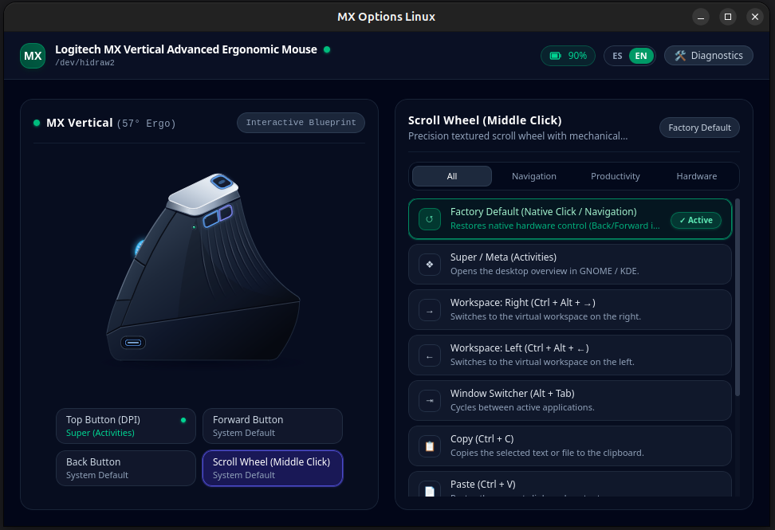

[English](README.md)

# MX Pilot

Suite nativa, ultraliviana y ergonómica para configurar ratones Logitech MX en Linux.

**MX Pilot** (`mx-options`) reemplaza el software oficial *Logitech Options / Options+* en Linux mediante comunicación directa con el protocolo **HID++ 2.0/4.5** e inyección de eventos a nivel de kernel por **`/dev/uinput`**, operando íntegramente en espacio de usuario sin privilegios de `root`.

<p align="center">
  
</p>


## Rendimiento y arquitectura

A diferencia de las utilidades pesadas basadas en Electron, MX Pilot desacopla un daemon nativo en Rust (`mx-daemon`) de su interfaz gráfica en Tauri v2 + Svelte 5 (`mx-gui`, renderizada sobre el motor WebKitGTK del sistema sin Node.js en tiempo de ejecución):

- **Memoria RAM del daemon (`mx-daemon`):** ~2.3 MB RSS en reposo
- **Paquete instalador (`.deb` / `.rpm`):** 4.15 MB (incluye los 5 binarios, iconos y reglas)
- **Latencia de extremo a extremo (`hidraw` → `uinput`):** menos de 5 ms
- **Puntuación de aislamiento `systemd-analyze security`:** 4.0 OK

## Funciones

- **Desvío completo de botones (*Button Diversion* HID++ 2.0/4.5):** reprograma el botón superior de DPI (`0x00FD`), la rueda central (`0x0052`) y los botones laterales de pulgar Adelante (`0x0056`) y Atrás (`0x0053`) del **Logitech MX Vertical** (por Bluetooth o receptor Unifying/Bolt)
- **Restauración nativa en caliente (*Función de Fábrica*):** devuelve cualquier botón a su comportamiento original de hardware (`BTN_SIDE`, `BTN_EXTRA`, `BTN_MIDDLE`) sin reiniciar el ratón
- **Emulación universal por `/dev/uinput`:** funciona de forma transparente en **Wayland** (GNOME, KDE Plasma, Sway, Hyprland) y **X11**, soportando pulsaciones sostenidas (*hold*) y atajos de escritorio (`Super/Meta`, cambio de espacio de trabajo `Ctrl+Alt+→/←`, `Alt+Tab`, `Copiar`, `Pegar`, `Silenciar`, `Play/Pausa`)
- **Garantía *Zero Dead Buttons* y *Zero Stuck Keys*:** guardianes RAII y scripts de paquete restauran automáticamente el firmware del ratón al detener el servicio o desinstalar la aplicación, evitando que el botón superior quede inerte
- **Blueprint interactivo de 57°:** ilustración técnica vectorial del MX Vertical con resaltado reactivo por botón, filtros por categoría y modal de telemetría interna en tiempo real
- **Bandeja del sistema (*System Tray*):** indicador con porcentaje de batería, estado de carga y reinicio rápido del servicio
- **Seguridad sin `root`:** reglas `udev` con `TAG+="uaccess"` y canal IPC por socket Unix (`0600`) autenticado mediante credenciales del kernel (`SO_PEERCRED`)
- **Interfaz en español e inglés:** detecta automáticamente el idioma del sistema e incluye selector interactivo `ES | EN` en la barra superior

## Herramientas incluidas

El paquete instala cinco binarios complementarios en `/usr/bin`:

| Binario | Función |
|---|---|
| `mx-daemon` | Servicio en segundo plano (`systemd --user`) que gestiona el protocolo HID++, la reconexión automática, `/dev/uinput` y el socket IPC |
| `mx-gui` | Interfaz gráfica de escritorio en Tauri v2 + Svelte 5 con bandeja del sistema y blueprint interactivo |
| `mx-cli` | Utilidad de línea de comandos para consultar estado, batería y probar desvíos desde la terminal |
| `mx-diag` | Herramienta de diagnóstico de permisos `udev`, convivencia de dispositivos y telemetría de salud |
| `mx-probe` | Sonda de bajo nivel para enumerar registros y características del firmware HID++ 2.0/4.5 |

## Requisitos

MX Pilot utiliza el motor web y las bibliotecas gráficas que ya incluye tu distribución de Linux en lugar de empaquetar un navegador Chromium propio. Por eso el instalador pesa apenas 4.15 MB.

| Distribución | Paquetes requeridos | ¿Se instalan solos? |
|---|---|---|
| **Debian / Ubuntu / Linux Mint / Pop!_OS** | `libwebkit2gtk-4.1-0`, `libgtk-3-0` (o `libgtk-3-0t64`), `libayatana-appindicator3-1`, `udev`, `systemd`, `procps` | Sí, declarados en el paquete `.deb` e instalados automáticamente con `apt` |
| **Fedora / RHEL / openSUSE** | `webkit2gtk4.1`, `gtk3`, `libayatana-appindicator-gtk3`, `systemd`, `systemd-udev`, `procps-ng` | Sí, declarados en el paquete `.rpm` e instalados automáticamente con `dnf` |

En Ubuntu 24.04 y posteriores el paquete de GTK se llama `libgtk-3-0t64`; el instalador `.deb` declara compatibilidad dual (`libgtk-3-0t64 | libgtk-3-0`), por lo que funciona directamente tanto en Ubuntu 22.04/Debian 12 como en Ubuntu 24.04+.

## Instalación

### Debian, Ubuntu, Linux Mint y derivados (`.deb`)

Descarga el paquete `.deb` desde la sección de [**Releases**](https://github.com/Panxio/mxpilot/releases). **Usa `apt` y no `dpkg`**, porque `apt` resuelve e instala automáticamente cualquier biblioteca compartida que falte:

```bash
sudo apt install ./mx-options_0.1.0-1_amd64.deb
```

### Fedora, RHEL y openSUSE (`.rpm`)

Descarga el paquete `.rpm` desde [**Releases**](https://github.com/Panxio/mxpilot/releases) e instálalo con `dnf`:

```bash
sudo dnf install ./mx-options-0.1.0-1.x86_64.rpm
```

### Primer inicio

Tras instalar el paquete, activa el servicio de usuario para tu sesión y abre la interfaz gráfica desde el menú de aplicaciones (**MX Options**) o la terminal:

```bash
systemctl --user enable --now mx-options.service
mx-gui
```

### Compilar desde el código

Requiere Rust (`1.80+`), Node.js (`20+`) y las cabeceras de desarrollo de Tauri v2 y `libudev`/`libevdev`.

En Debian/Ubuntu:

```bash
sudo apt update
sudo apt install -y build-essential libwebkit2gtk-4.1-dev libappindicator3-dev \
  librsvg2-dev libudev-dev libevdev-dev dpkg-dev rpm cpio
```

En Fedora:

```bash
sudo dnf install -y gcc gcc-c++ make webkit2gtk4.1-devel gtk3-devel \
  libayatana-appindicator-gtk3-devel librsvg2-devel systemd-devel libevdev-devel rpm-build
```

Compilar, verificar tests y generar los instaladores `.deb` y `.rpm`:

```bash
npm --prefix crates/mx-gui/ui ci
npm --prefix crates/mx-gui/ui test
cargo test --workspace

# Generar paquetes de distribución en target/
./scripts/package-deb.sh
./scripts/package-rpm.sh
```

## Licencia

Este proyecto está publicado bajo la licencia **GNU General Public License v2.0 (GPL-2.0)**. Consulta el archivo [`LICENSE`](LICENSE) para más información.

*Aviso: MX Pilot es un proyecto independiente de código abierto y no está afiliado ni respaldado por Logitech.*
